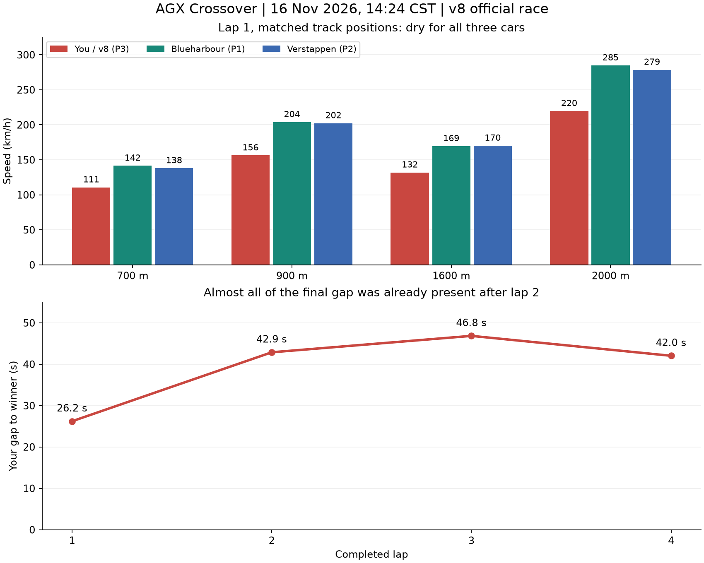

# v8 正式比赛第三名复盘：立交八字赛道

比赛 [a5032997-9458-4e0a-b338-ff4858eac6bf](https://agx.cool/#/matches/a5032997-9458-4e0a-b338-ff4858eac6bf)，北京时间 2026-11-16 14:24:58 结算。本人 zkdw66 为 3 号车，冠军 Blueharbour 为 10 号车，第二 Verstappen 为 2 号车。

**结论：这次主要是正常弯速及制动规划偏保守，另有起步省油误触发和末圈跟车损失。不是 v8 未生效，也不是上一场的急弯失稳保护持续误触发。** 正常弯速的具体安全上限仍需实测校准，不能直接照抄对手速度。

## 成绩和燃油

| 项目 | 冠军 Blueharbour | 第二 Verstappen | 本人 v8 |
| --- | ---: | ---: | ---: |
| 总时间 | 8:40.553 | 8:45.261 | 9:22.575 |
| 相对冠军 | 0 | +4.708 s | +42.022 s |
| 官方最快圈 | 1:46.668 | 1:49.165 | 2:08.020 |
| 发车位 | 1 | 2 | 7 |
| 配重 | 20 kg | 40 kg | 20 kg |
| 初始燃油 | 7.5 kg | 7.5 kg | 8 kg |
| 终点燃油 | 3.1212 kg | 3.1497 kg | 3.5014 kg |
| 初始配置至终点耗油 | 4.3788 kg | 4.3503 kg | 4.4986 kg |
| 采样最高速度 | 320.20 km/h | 319.45 km/h | 338.73 km/h |
| 进站次数 | 1 | 1 | 1 |
| 进站总耗时 | 42.334 s | 42.334 s | 42.334 s |

三人均软胎起步、换中性胎完赛；前后翼、车高、齿比、散热开口等可见主要配置相同。第二名比本人重约 19.5 kg（配重加初始燃油差），仍快 37.314 秒。不能把差距主要归因于车辆重量或维修区耗时。公开第一帧本人已经耗掉 0.0001 kg，分析器的首帧到末帧消耗为 4.4985 kg；表格以初始配置 8 kg 为基准。

## 时间主要在前两圈丢失

按公开帧插值，过第 1、2、3、4 圈终点线时，落后冠军约 26.2、42.9、46.8、42.0 秒。末圈反而比冠军少用约 4.8 秒，但未能补回前期差距。

这些累计时间以发车时刻为起点，包含起跑排位位置及进站影响；第一段不是平台的官方最快圈口径。终点采样与官方精确判定存在约一个物理步的偏差，总成绩以官方分类表为准。

## 1. 干地、无跟车干扰时，正常弯速仍明显偏低

以下均为第一圈同位置最近公开采样，三车当时赛道湿度均为 0：

| 赛道位置 | 本人 | 冠军 | 第二 |
| --- | ---: | ---: | ---: |
| 700 m | 110.6 km/h | 141.6 km/h | 138.0 km/h |
| 900 m | 156.3 km/h | 203.8 km/h | 202.2 km/h |
| 1600 m | 131.9 km/h | 169.4 km/h | 170.1 km/h |
| 2000 m | 219.6 km/h | 284.8 km/h | 278.5 km/h |

本人控制日志对应样本没有跟车降速、没有省油、没有失稳风险。在约 1600 m，规划目标只有 133.1 km/h，实际约 131.8 km/h，油门约 20%；当前抓地力限幅也没有截断该油门。此处直接限制速度的是规划目标。约 2000 m，程序已按前方弯道进行制动，而对手在同位置仍接近 280 km/h。

现有规划使用基础摩擦系数 1.75，再叠加胎方、低温、湿度和 0.92 横向余量。这些是代码中的工程假设，并非已知的游戏真实轮胎参数。第一圈本人在赛道内平均胎温约 71.6°C，前两名约 79.9°C；第二圈本人约 60.9°C、前两名约 68.5–68.7°C。较低胎温进一步降低本人的规划抓地估计，存在“慢速—低胎温—更保守目标”的反馈可能，但尚未用改变策略后的真实比赛证明这条因果链。

四圈合计 580–1161 m 区间落后冠军约 17.72 秒；1161–2321 m 区间约 15.88 秒。两者合计 33.60 秒。部分直道本人更快，因此这些是各区间的观察差值，不是独立可回收收益。

## 2. 起步油耗外推导致不必要的省油

约第 7.73–16.30 秒，共 258 次决策、8.6 秒触发省油。最明显样本在第 7.77 秒、约 104 m：

- 剩余油量 7.9136 kg；程序将起步约 150 m 的耗油率外推，预测剩余赛程需要约 13.09 kg。
- 当时目标约 399.8 km/h，实际约 216.6 km/h，没有跟车或失稳限制，原需求为满油门。
- `fuel_power_scale` 只有 0.6044，实际油门被压到约 60.4%。
- 本场最终实际耗油仅 4.4986 kg，证明该阶段预测明显偏高。

优先修正采样成熟度和启动阶段耗油的代表性，采用充分行驶数据、平滑估计及不确定性处理；这项问题不能通过继续多加油来解决。8.6 秒是限制持续时间，不等于损失了 8.6 秒。

## 3. 第四圈跟慢车，弯中通过策略仍有限

第 434.53–454.20 秒、约 667–1064 m，跟车模块连续限制约 19.7 秒。第 440 秒，前车为 seat 5（6 号车、gugugaga），仅约 9.57 m 前方，速度约 90.1 km/h，本人已是第 4 圈，对手为第 3 圈。

v8 只放开了低速绕过近乎停驶车辆，并没有解决这类“前车仍在行驶、连续弯中明显慢于本车”的情形。该圈 580–1161 m 区间实际落后冠军约 7.97 秒，但不能把全部 19.7 秒跟车时间当作可追回损失。需要有持续空间检查的通过策略，不能简单取消碰撞保护。

## 4. 能量分配有改进空间，但不是总电量明显更少

本人赛道内攻击模式时间占比约 8.8%，前两名约 15.3%、15.6%；本人电量低于 0.02 MJ 的赛道内时间约 13 秒，前两名没有落入该阈值。第一圈攻击模式占比分别约 12.7%、22.2%、22.8%，前两名更早使用进攻功率。

终点遥测累计部署电量却很接近：本人约 16.876 MJ，冠军 16.927 MJ，第二 17.143 MJ。因此应研究功率使用的位置、时机以及与弯道目标的配合，不能简单把攻击模式占比翻倍当作答案。

## v8 是否修复了上一场问题

本场训练元数据明确指向 v8：version_id `46ff6cc3-bcbf-4522-b5c6-9c023e2f353c`，包指纹 `f9da6220f841512ddc7ae8bdbdf3ea8253ba8369b448c6a0cd42c4c8857a5f47`。当前源码重放全部 20993 条本人合法观察，动作与原记录零差异、零异常、零非法动作。

15608 次赛道内决策中，姿态风险大于 0 仅 61 次，约 2.03 秒，全部出现在第一圈；后面三圈为 0。因此本场持续落后不能归于失稳保护反复误触发。比赛换成 Crossover，正赛还有间歇降雨、最高湿度 0.25，不能据此声称 Highland 同条件性能已提升多少。

## 优化顺序与证据边界

1. 校准正常弯速和制动规划：用真实速度、横向载荷、胎温、滑动和姿态数据约束抓地估计，分段提高目标并保留真正失稳保护。
2. 修正启动阶段的燃油外推，避免错误省油。
3. 为行驶中的慢车完善通过判断和持续空间检查。
4. 在前述问题解决后调整电能分配，避免末段空电。

前三名的私有代码不可见，不能确认其具体算法；对手可实现的速度是比较证据，不是本车照抄即可安全完成的证明。本次为分析，未改运行车手、8 kg 配置或重新上传版本。

数据完整性：139 个连续公开帧分块哈希校验通过，覆盖完整正赛 15922 个采样帧；静态和事件流的哈希、字节数、行数通过。本人完整训练日志另经原始字节、行数、SHA256、席位计数及 `export_complete` 核验。原始日志置于忽略目录。

聚合证据：[前三名比较](../experiments/podium-v8-comparison-2026-11-16.json)、[分圈遥测](../experiments/crossover-v8-podium-details.json)、[控制诊断](../experiments/crossover-v8-control-diagnostics.json)、[实际版本重放](../experiments/replay-v8-official-crossover.json)。
