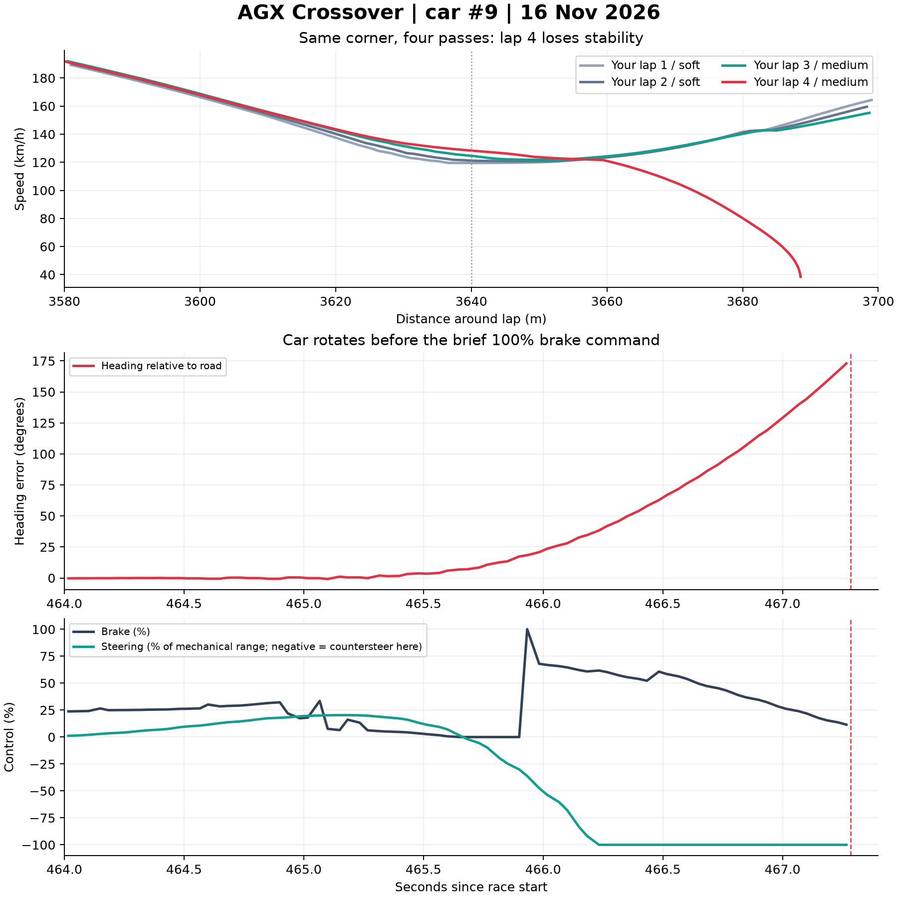

# 2026-11-16 Crossover 损坏退赛复盘

结论：zkdw66 的 9 号车在第 4 圈约 3640–3690 m 的弯道内逐渐甩尾，反打方向与制动未能恢复，随后平台以 `damage` 判退赛。退赛前仍排第 2，最终第 8。可以确认失稳过程，不能从公开数据确定具体损坏部件或隐藏损伤累计机制。

后续更新：用户授权修复并提供已登录浏览器后，已取得并核验本人完整 17724 次决策，v5 基线与原动作完全一致。v7 已修正相关控制逻辑、通过准入并发布；新取得的轴滑动与控制证据、验证结果见 [v7 修复记录](v7-stability-2026-11-16.md)。下文保留最初公开回放分析的取证范围和当时限制。

## 数据与版本

- 比赛 `5a946509-cb5d-4333-99e6-be10b659fee4`，北京时间 10:24:12 结算，Crossover / 立交八字赛道，圈长 5803.167 m。
- 来源：[官方回放描述与结果](https://agx.cool/api/v1/python-submissions/recordings/5a946509-cb5d-4333-99e6-be10b659fee4/replay/descriptor)、对应公开静态数据、事件与帧，以及[官方赛道几何](https://agx.cool/assets/formula-circuits/crossover.json)。
- 已核验静态流、全部 9400 条事件的 SHA256、字节数和行数；逐个核验 133 个连续帧分块（236–368）的 SHA256，覆盖完整正赛 15922 帧。24 Hz 公开采样，60 Hz 物理时钟，帧间隔无缺口，终点精确匹配。没有下载完整排位帧流，也不声称核验了完整排位帧流的整体哈希。
- 正赛始于全局 tick 81984，即回放全局时间 1366.4 s。下文时间均从正赛发车算起，避免与包含排位的回放时间混淆。
- 本场初始燃油 **15.0000 kg**；与旧配置一致，确定不是上传的 **8 kg** 包。由于未取得该场私有版本锁定记录，不将“v5 的精确版本 ID”写成已经核实的事实。
- 本次最初的已登录查询（10:26:27）确认：新包审核 `passed`，版本号 **6**，版本 ID `12a43477-0bd8-4fbc-9d1b-76040be7376a`，包 SHA256 `163ae28f38abc955cf2989673a29d6e3c19b4261d1bf9d8bcb1e13199424a606`。之后浏览器会话失去登录，无法继续取得私有逐步观测、内部控制目标和完整损伤状态；公开回放仍可核验。新版本已发布不证明这场历史比赛使用了新包，也未重新验证报名页当前选择。

## 比赛过程

| 项目 | 你的 9 号车 | 冠军 2 号车 |
| --- | ---: | ---: |
| 最终名次 | 8，损坏退赛 | 1，完赛 |
| 完成圈数 | 3，正在跑第 4 圈 | 4 |
| 官方总时间 | 467.283 s | 507.178 s |
| 官方最快圈 | 118.824 s | 108.257 s |
| 进站次数 | 1 | 1 |
| 初始燃油 | 15.0000 kg | 7.5000 kg |
| 最终燃油 | 10.7411 kg | 2.8544 kg |
| 已消耗燃油 | 4.2589 kg，未完赛 | 4.6456 kg，完整四圈 |

不能将退赛时间比冠军短解读成更快，也不能把退赛油耗直接当作四圈油耗。

你的发车位为第 4。发车后 2.367 s 升至第 3，5.300 s 升至第 2；最后一个仍在比赛的公开帧仍为第 2。进站时间 232.217–274.567 s，平台记录进站总耗时 42.334 s，其中停车 2.4 s，软胎换中胎。采用两种干地胎符合本场干地策略需求；仅凭这次结果，没有证据说明进站失误是退赛原因。

## 失稳的最后两秒

航向偏差为车头方向相对于当前道路切线的角度，由公开坐标、朝向及官方几何推算；不是获得了私有 `heading_error` 观测。

| 正赛时间 | 圈内距离 | 车速 | 航向偏差 | 制动 | 现象 |
| --- | ---: | ---: | ---: | ---: | --- |
| 7:45.350 | 3640.6 m | 128.1 km/h | 1.4° | 5.1% | 转弯，已有小幅偏差 |
| 7:45.567 | 3648.1 m | 124.6 km/h | 4.1° | 1.7% | 偏差开始明显扩大 |
| 7:45.767 | 3654.9 m | 122.3 km/h | 10.7° | 0% | 已反打，但旋转继续 |
| 7:45.933 | 3660.5 m | 120.4 km/h | 18.4° | 100% | 出现短促满刹；甩尾发生在此之前 |
| 7:46.400 | 3674.5 m | 95.6 km/h | 54.1° | 53.9% | 反打达到机械最大角度 -0.3 rad |
| 7:47.017 | 3686.9 m | 54.5 km/h | 131.7° | 26.1% | 车头已经大幅反向 |
| 7:47.267 | 3688.5 m | 38.5 km/h | 172.9° | 11.5% | 最后仍在比赛的公开帧，接近掉头 |
| **7:47.283** | — | — | — | — | **精确退赛事件：`reason=damage`** |

首次公开退休帧是 7:47.317，车速被置零、制动变为 100%。这是退赛后的状态，不能将它作为导致退赛的满刹证据。上表真正发生在退赛前的满刹是 7:45.933。



## 可以排除到什么程度

- **不是燃油耗尽**：退赛还剩 10.7411 kg，且本场没有采用 8 kg 起步。
- **不是这几秒被旁边在跑的车撞上**：最后约三秒，所有仍在比赛的对手与本车的三维直线距离最小约 158.7 m。事件流没有接触事件，但“没有接触事件”本身不足以证明全场没有历史碰撞或累计损伤。
- **不是正赛突然下雨**：完整正赛公开帧的路面湿度均为 0；天气变化事件发生在排位阶段。
- **不支持轮胎已经磨光或公开胎温过热**：进入事故弯时最大单轮磨损约 3.49%，退赛约 3.55%；当时四轮最高胎温约 65°C，旋转后上升到 69.35°C。这里的低温是否足以改变抓地，需轮胎模型或正式试跑验证，不能只根据温度断言原因。
- **不能确认撞墙或具体机械故障**：最后车心横向偏移约 4.39 m，赛道半宽约 5.75 m。车心仍在道路宽度内不等于车身所有部分都未触碰边界，也不能解释隐藏损伤阈值。公开数据不含损伤数值、动力单元温度或部件故障分类，故不写成“已证实撞墙/爆胎/发动机烧坏”。

另外两辆损坏退赛车分别在首圈约 2731 m、2729 m 退赛，与你的事故地点不同，不能把三个退赛简单归并为同一个弯的问题。

## 为什么前三圈能过，第四圈却失稳

比较本人四次经过约 3640 m 的最近公开采样，而不是比较不同地点的最低车速：

| 圈数 | 胎种 | 速度 | 四轮最高胎温 | 最大单轮磨损 | 航向偏差 |
| --- | --- | ---: | ---: | ---: | ---: |
| 1 | 软胎 | 119.5 km/h | 74.34°C | 1.73% | 0.05° |
| 2 | 软胎 | 121.1 km/h | 66.54°C | 3.91% | -0.13° |
| 3 | 中胎 | 124.3 km/h | 66.48°C | 1.24% | 0.45° |
| 4 | 中胎 | **128.1 km/h** | **65.02°C** | **3.49%** | **1.41°，随后快速扩大** |

第 4 圈比第 3 圈在同一位置快约 3%；如果路线曲率相同，所需横向加速度约增加 6%。这是抓地余量更小的线索，不是证明单一原因的控制实验：油量、轮胎、路径与反馈状态同时变化，且公开采样位置存在小量差异。

冠军第 4 圈同处约 104.3 km/h，路线横向位置约 +2.99 m，你约 -0.40 m，不能直接照搬其速度。冠军第 1 圈同处甚至达到约 159.9 km/h，足以说明“这个弯固定限速 104”不成立；应比较路线和车辆状态，并根据可用抓地分配制动与转向。

## 代码中对应的风险，以及修复顺序

对照本地 v5 基线和当前 v6，下面的过弯与姿态控制问题仍存在。它们是可复核的代码限制，具体各占多少事故原因仍需私有观测与实跑确定。

1. **抓地估计没有区分胎种，也没有冷胎修正。** 基础系数为 1.75，只按湿度、磨损和超过 118°C 的高温衰减。换上中胎或胎温下降时，模型没有对应的抓地变化；换新胎降低磨损反而可能提高其估算能力。应先加入经观测校准的胎种/温度因素和不确定性余量，重点验证这段弯，不能凭空给出保证安全的系数。
2. **弯中制动与转向没有共享抓地预算。** 制动距离规划沿用纵向制动能力，再叠加弯道速度约束；纵向控制还会跟踪目标速度下降速率。v6 的横向抓地余量只用于 ERS 动力档位选择，并没有同样约束弯中制动。这一层需要联合限制纵横向需求，既避免刹晚，也避免已经大幅转弯时仍请求过大的纵向制动。
3. **失稳保护存在目标突变风险。** 航向偏差超过 0.30 rad（约 17.2°）后，目标速度上限变为 18 m/s；更大航向偏差或侧滑则降到 8 m/s。控制器将目标下降速率直接计入制动需求。实测约 18.4° 时出现短促满刹，与该机制相符，但缺少当次输入与内部目标，不能断言精确命中哪个分支。应更早利用侧滑和偏航趋势识别失稳，并使恢复制动与剩余抓地匹配；碰撞紧急制动仍需单独保留。
4. **反打已饱和，不能只增加转向增益。** 实测转向到达 -0.3 rad 后，车头还从约 54° 转到 173°。重点是更早预防及协调制动，不是单纯把方向打得更猛。

建议先对 3580–3700 m 这个弯验证中胎后半程的保守抓地估计、提前制动和早期失稳恢复，再对其余赛道回归。8 kg 燃油可以保持为用户选定的配置，但减重不是稳定性修复，也不能从本场 15 kg 的结果证明 8 kg 稳定。优化 ERS 或增加攻击性应排在完赛稳定性之后。

本次仅完成数据分析、图表及提交状态记录更新，未改变车手运行代码、设计文件或重新上传。此前 85 项测试和简化运动学检查没有证明真实轮胎极限下的稳定性，不能替代正式物理试跑。

## 复现

```bash
python3 scripts/analyze_damage_replay.py data/private/damage-2026-11-16
```

默认生成 `experiments/damage-analysis-2026-11-16.json`，包含核验范围、事故采样、每圈同弯采样与误差说明。安装 matplotlib 后可增加 `--plot docs/assets/damage-2026-11-16.png`，输出 PNG 与 SVG；绘图库只用于离线报告，不进入赛车提交包。既有 `experiments/damage-race-comparison-2026-11-16.json` 保存全场与冠军对照。
