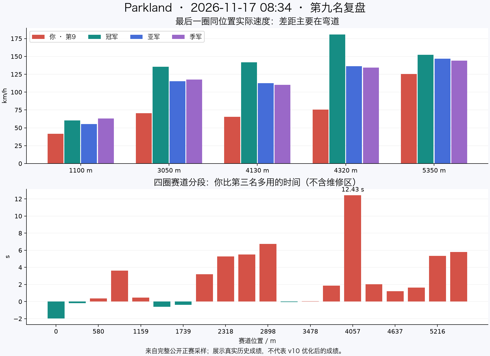

2026-11-17 赛车复盘与 v10 本地候选版
====================================

核查至北京时间 2026-11-17 12:12。用户是 zkdw66。第九名对应 08:34 完成的 Parkland，随后 10:35 完成的最新一场仍在 Parkland，用户是第二名。两场都使用已发布 v9；随后用户授权上传：v10 已于北京时间 12:23:15 上传，12:29:31 核验准入通过，正式版本号 10；尚无 v10 新正式成绩。

**两场正式结果**

| 完赛时间（北京时间） | 路况 | 排位 | 正赛 | 总时间 | 落后冠军 |
| --- | --- | ---: | ---: | ---: | ---: |
| 11-17 08:34 | 干地/轻微潮湿，湿度 0–0.250 | 10 | 9 | 465.754 s | 66.671 s |
| 11-17 10:35 | 正赛起步湿度 0.944889 | 9 | 2 | 502.384 s | 64.553 s |

[第九名比赛](https://agx.cool/#/matches/34a01024-c4a0-4e4b-a184-2a196ade0ae9)与[最新亚军比赛](https://agx.cool/#/matches/88998e7d-e746-4ae0-8f11-a6c39e941e91)的天气和对手不同，不能把总用时直接跨场比较。两场均落后冠军约一分钟，名次回升不等于绝对速度已经接近冠军。最新场第三名羊宫妃那为 503.343 s，用户只领先 0.959 s。

**第九名这场，前三名究竟快在哪里**

| 车手 | 名次 | 总时间 | 官方最快圈 | 排位圈速 | 最高速度 | 满油门时间占比 | 刹车时间占比 |
| --- | ---: | ---: | ---: | ---: | ---: | ---: | ---: |
| ZephyalGates | 1 | 399.083 s | 91.792 s | 89.689 s | 341.6 km/h | 71.1% | 16.6% |
| King | 2 | 412.654 s | 96.302 s | 89.746 s | 340.3 km/h | 59.8% | 19.3% |
| Kei | 3 | 413.418 s | 95.930 s | 88.456 s | 341.8 km/h | 66.5% | 18.4% |
| zkdw66 | 9 | 465.754 s | 107.681 s | 102.621 s | 342.5 km/h | 48.7% | 25.2% |

油门与刹车占比来自完整正赛公开帧、按时间加权、排除维修区；满油门阈值 >0.95，刹车阈值 >0.05。最高速度是全场活动状态峰值，并非持续速度。你与第三名差 52.336 s，即总用时需缩短约 11.24%；简单平均为每圈 13.084 s，但损失分布并不均匀。

四车都完整跑完四圈，只有一次进站；维修区实际通行+服务耗时均为 35.7658 s。冠军软胎跑三圈再换中胎；你、亚军、季军均软胎两圈、中胎两圈。不能将冠军优势归因于少进一次站。你终点剩油 3.0208 kg，完整本人日志没有省油触发，没有运行故障。

最高速度相当而排位已经慢 14.165 s，说明基础速度损失在没有正赛交通干扰时也存在。第一圈你从第十升到第七，45.417 s 在约 2306 m 发生一次接触；到约 60 s 为第八。最后一圈约 447.917 s 被 trymybest 超过，最终仅落后第八 0.696 s。该接触与末圈超车解释了部分名次变化，但无法解释整场与前三名的巨大正常圈速差距。

**实际弯道速度与时间损失**

| 最后一圈位置 | 你 | 冠军 | 亚军 | 季军 |
| --- | ---: | ---: | ---: | ---: |
| 1100 m | 41.6 | 60.3 | 55.1 | 63.0 |
| 3050 m | 70.3 | 135.6 | 115.3 | 117.7 |
| 4130 m | 65.3 | 141.6 | 112.5 | 110.2 |
| 4320 m | 75.3 | 180.7 | 136.2 | 134.3 |
| 5350 m | 125.6 | 152.1 | 146.9 | 144.2 |

单位 km/h，采用各车该圈距离目标站位最近的公开帧，非同一时刻。四圈累计，你相对季军在 4057–4347 m 损失 12.43 s，在 2898–3188 m 损失 6.73 s，在 2608–2898 m 损失 5.52 s，在 5216–5506 m 损失 5.33 s。这四段合计约 30.01 s，占总差距约 57%；是同一位置耗时差，并非可直接回收的优化收益。

前三名短弯中的转向与路线也有明显差异。例如 4130 m，你的实际前轮角约 0.1405 rad，冠军约 0.0547 rad；相应速度为 65.3 和 141.6 km/h。公开帧支持“轨迹/转向行为存在差异”，但不能反推出对方源代码，也不能仅凭转向角证明某一种路线算法。当前候选版仍完整检查中心线曲率峰值；若要进一步追赶，需独立建立和验证道路边界内的行驶路线，不能简单删掉急弯样本。

**本人的合法观察与源码解释**

完整导出 17,261 次决策，核对原始字节、行数和 SHA256。回放 v9 与平台记录动作零差异，确认本地诊断确实复现了参赛版本。

- v9 的干地抓地修正依赖最低单轮胎温 >65°C。正赛第二圈最低胎温均值 57.68°C，第三圈 61.69°C，第四圈 54.49°C；第二、第四圈该修正完全失效。仍存在温度惩罚，但额外校准被全部撤销。这是可观察的参数门槛问题；并不意味着真实冷胎应具有与热胎相同的抓地。
- v9 用下压力计算弯速和即时力预算，却在反推制动点时把减速度截断在低速 `mu*g`。高速可用的下压力制动余量被忽略，导致提前减速。应结合当下实测下压力近似值、制动器上限、坡度和横向需求计算，而不能全程只用低速上限。
- 本场正赛在赛道上的 12,900 次决策中，省油 0 次；失稳检测仅 59 次、约 0.46%。第二至第四圈没有交通限速。不能把这些正常弯区损失归咎于省油、持续跟车或失稳检测误报。
- 电量低于 0.02 MJ 的在赛道时间占比为 27.5%，前三名为 0%。冠军 attack 档占比仅 2.8%，你约 9.9%，说明“更常开最大电力”并不等于更快。能量分配仍是后续实验点，但回放不能单独证明哪一种电量预算能带来净圈时收益，本次没有凭空新增保电限速规则。
- 车辆配重你是 20 kg，亚军和季军是 40 kg；燃油分别为 8、7.5、8 kg。冠军为前翼 25/后翼 19.5、散热开度 0.6、燃油 8.5 kg；你为前翼 20/后翼 22、散热 0.7、燃油 8 kg。冠军设计有区别，但公开比较无法分离底盘、路线与驾驶程序的因果贡献，本次保留车辆设计以隔离驾驶变化。

**已经实施的 v10 候选优化**

1. 冷胎干地校准：保留原有温度、磨损、胎方、过热惩罚；额外干地修正在 40–55°C 从 0 平滑增至 14%，55–80°C 再增至 28%。最高修正仍为 28%，没有提升既有热胎上限。湿度 0–0.30 线性衰减，湿度 ≥0.30 或胎温 ≤40°C 无额外修正。该校准是有界工程假设，仍需新比赛验证。
2. 干地制动规划：利用随速度变化的下压力预算，同时保留制动器最大力、联合纵横向抓地、坡度、完整约 2 米地图节点和反应距离。每段取上下游更保守的可用减速度，避免把高速下压力当成整个制动过程的恒定力。湿度升至 0.30 时回退 v9 制动上限。

下表为**相同历史输入上的控制变化**，不是新比赛成果：

| 指标 | v9 | v10 候选 |
| --- | ---: | ---: |
| 正赛在赛道上刹车 >0.05 的决策占比 | 25.24% | 15.00% |
| 同样输入的满油门决策占比 | 48.64% | 57.19% |
| 失稳检测触发 | 59 | 59 |
| 第四圈 1100 m 规划速度 | 43.3 km/h | 46.3 km/h |
| 第四圈 2700 m 规划速度 | 120.8 km/h | 130.8 km/h |
| 第四圈 4200 m 规划速度 | 160.2 km/h | 174.3 km/h |
| 第四圈 5400 m 规划速度 | 131.6 km/h | 141.4 km/h |

例如第四圈约 900 m，v9 已请求 14.1% 刹车，候选版解除该时刻制动；接近弯道后仍计算必须满足的弯速和剩余制动力。历史轨迹不会随新动作改变，因此这里不能推出新的制动距离、圈速、碰撞率或排名。部分尖锐弯的候选规划速度仍明显低于前三名，不能宣称这两项修正已经足够收回全部 52 秒。

**交叉验证与交付**

- 125 项测试通过，新增覆盖冷胎修正连续性/边界、机械制动上限、下压力制动规划以及独立标量积分的理想制动上界。
- 30,000 次合成调用：零异常/非法动作，act CPU 6.656 s，p99 0.300 ms。该值不含 JSON 和平台开销。
- Parkland 第九名场 17,261、Highland 25,145、Crossover 历史事故场 17,724 次完整合法观察重放，共 60,130 次，零异常/非法动作。
- 旧事故的首次失稳检测仍为 465.333 s；不等于已证明能救回事故。
- 三赛道、湿度 0.30/0.80/1.00、不同胎温的 9,000 次合成序列，与 v9 动作零差异。没有声称覆盖从干转湿的所有有状态过渡。
- 三条赛道的简化自行车模型均完成一圈、未越道路边缘；另测 55°C、下压力系数 1.2 的合成场景，三赛道也全部通过。模型没有真实轮胎、碰撞、天气与完整动力单元，模型时间不用于预测正式圈速。
- 最新亚军场公开数据完整；本人决策导出返回 `409 training_trace_incomplete`，因此没有伪造该场私有输入，不能声称对该场完成了私人日志重放。

候选包：`dist/agx-racing-v10-candidate.zip`，SHA256 `4e36a195502d1a1f71c0f906ce1930963aeb23ac6656f761b8ed1d1baea514fa`。六个运行文件，燃油保持 8 kg，原始训练数据不进入包。**已按用户后续要求上传 AGX，准入 passed，版本 10；文件指纹与本次验证完全一致。** 发布回执见 [submission-v10.json](../experiments/submission-v10.json)。

证据与复现：

- [第九名场完整正赛聚合](../experiments/latest-podium-2026-11-17.json)：11,213 帧，98 个连续分块；核对事件、场景、分块 SHA256、首尾 tick 和采样连续性。
- [最新亚军场聚合](../experiments/newest-podium-2026-11-17.json)：13,121 帧，120 个连续分块，同样核验。
- [v9 控制诊断](../experiments/v9-parkland-diagnosis.json)、[v10 控制诊断](../experiments/v10-parkland-diagnosis.json)、[本场双版本重放](../experiments/replay-v10-parkland.json)、[湿地回退对比](../experiments/v10-wet-fallback.json)、[包指纹](../experiments/package-v10-candidate.json)。
- `python3 -B -m unittest discover -s tests -q`
- `python3 -B scripts/analyze_race_comparison.py data/private/latest-2026-11-17 --seat 8 --output experiments/latest-podium-2026-11-17.json`
- `python3 -B scripts/diagnose_pace.py data/private/latest-2026-11-17/training.jsonl --output experiments/v10-parkland-diagnosis.json`
- `python3 -B scripts/check_v10_wet_fallback.py`
- `python3 -B scripts/kinematic_check.py --body-sideslip --downforce-coefficient 1.2 --tyre-temp 55`

分段耗时和圈线通过时间来自 24 Hz 采样插值，官方总时间/最快圈优先。发车至第一次完成整圈的耗时包含起步到计时线的时间，不能与官方首圈最快圈字段混用。前视与回放只用于离线研究；实时策略仍只使用合法自身观察及公开几何。
