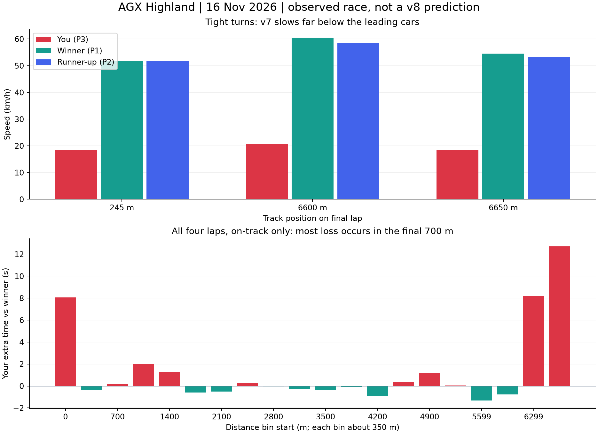

# Highland 第三名复盘与 v8 优化

比赛 `1482e250-9d95-49eb-8f78-77df3daa1810`，北京时间 2026-11-16 12:21:42 结算。本人 zkdw66 是 5 号车（seat 4），使用 v7、8 kg 燃油，四圈完赛第三。v7 基线对本场完整合法日志重放，与原动作零差异。

## 成绩与油耗

| 项目 | 冠军 trymybest（9 号车） | 第二 aiyameishi（6 号车） | 本人（5 号车） |
| --- | ---: | ---: | ---: |
| 总时间 | 637.147 s | 639.600 s | 666.155 s |
| 与冠军差距 | 0 | 2.453 s | 29.008 s |
| 最快圈 | 146.846 s | 146.388 s | 154.540 s |
| 发车位 | 4 | 8 | 7 |
| 进站次数 | 1 | 1 | 1 |
| 进站总耗时 | 34.648 s | 34.648 s | 34.648 s |
| 初始燃油 | 9 kg | 9 kg | 8 kg |
| 终点余油 | 3.6915 kg | 3.5581 kg | 2.5133 kg |
| 按初始配置至终点计算耗油 | 5.3085 kg | 5.4419 kg | 5.4867 kg |
| 公开采样最高车速 | 332.59 km/h | 332.19 km/h | 340.48 km/h |

冠军平台昵称原文为 `trymybest`。本人的完整决策日志最后一条稍早于完赛，那里余油 2.5140 kg，计算耗油 5.4860 kg；终点公开帧继续消耗约 0.0007 kg。本报告最终油耗以终点帧为准。公开帧第一条已经消耗约 0.0001 kg，所以通用分析器的“首采样到末采样消耗”字段为 5.4866 kg，三种口径不混用。

本场没有燃油不足；本人比前两名少带 1 kg，最高车速也更高。前三名的停站耗时相同，29 秒差距主要在赛道驾驶。前两名散热开口 0.6、本人 0.7，其余可见主要配置相同；仅凭这个差别不能归因全部圈速损失。本次保留燃油及车辆配置，优先修正有直接控制证据的问题。

## 主要失时点

按约 350 m 的空间区间累计完整四圈的赛道行驶时间，排除维修区自动通行：

- 6299–6649 m：本人比冠军多用约 **8.217 s**。
- 6649–6999 m：多用约 **12.717 s**。
- 最后约 700 m 合计 **20.934 s**，约占总差距 72%。这表示历史差距的位置，不是 v8 已追回的时间。
- 0–350 m：多用约 **8.05 s**，同时存在急弯误判与交通阻塞。其它区间有小幅得失，合并后得到整场差距。

最后一圈，同位置的最近公开采样：

| 圈内位置 | 本人 | 冠军 | 第二名 |
| --- | ---: | ---: | ---: |
| 245 m | 18.4 km/h | 51.7 km/h | 51.7 km/h |
| 6600 m | 20.5 km/h | 60.5 km/h | 58.4 km/h |
| 6650 m | 18.4 km/h | 54.5 km/h | 53.3 km/h |

## 已确认的控制问题

**v7 的失稳检测误判了低速急弯中的正常车身运动。** 例如最后一圈约 234.55 m，真实航向偏差 +0.12362 rad、侧向速度对应角度 -0.12362 rad，两者几乎抵消，车辆运动方向仍沿道路；v7 单看两者的绝对值却给出约 0.29 的恢复强度，强制收油/轻刹。它会一路减速到低速保护退出门槛附近，形成数处约 18–20 km/h 的不必要低速。

这与先前 Crossover 的真正甩尾不同：那里侧向运动与偏航旋转方向相反，偏航又超过道路所需，旋转持续增长。不能为了追回速度而整体关闭失稳保护。

**慢车绕行仅允许在直道，造成弯中排队。** 本人首圈 20.233–45.033 s，速度低于 1 m/s 约 24.8 s，停在约 239–241 m，前方赛车距离约 6.3 m。旧逻辑既要求直道，也要求较大的绕行触发距离，因此没有选择空闲侧向通道。冠军第二圈低于 1 m/s 的两次停留合计约 23.67 s，第二名约 21.75 s；两者也受阻，不能把本人的 24.8 s 全部当成独有差距。

ERS 仍有次要改进空间：本人非维修区赛道行驶时间约 10.38% 处于电量低于 0.02 MJ，前两名没有出现该情况。不过本人最高速更高、主要失时集中在三个急弯，本次先修复已定位的误判和绕行，保留 ERS、胎方/温度抓地模型和横向余量，以控制改动范围。

## v8 修改与验证

1. 用“车头偏角 + 侧向运动角”判断实际运动方向是否偏离道路；早期甩尾恢复还须符合“旋转超过道路所需、侧向运动与旋转相反”的证据。正常紧弯中两个角度互相抵消时不再强制减速。严重航向偏差、严重侧滑与真实过度旋转仍受保护。
2. 仅在本车低于 6 m/s、前车低于 3 m/s、前方距离至少 6 m 且侧向通道与道路宽度足够时，允许在弯中启动低速绕行；原有跟车距离、并行车辆检查和碰撞紧急制动保持。高速弯、窄弯和被占用的逃离通道不启用该例外。
3. 8 kg 燃油及其余车辆设计不变，ERS 与抓地估计不变。

| 检查 | 结果 |
| --- | --- |
| 单元与回归 | 106 项通过 |
| Highland 完整历史观察 | 25145 次零异常/非法动作；v7 与原动作零差异 |
| Crossover 完整历史观察 | 17724 次零异常/非法动作；继续保留真实事故恢复 |
| 检测触发 | Highland 赛道上 1133/18945 → 55/18945（约 5.98% → 0.29%） |
| 旧事故介入时间 | v7、v8 均为正赛 465.333 s，没有推迟首次响应 |
| 合成压力 | 30000 次零异常/非法动作，act CPU 9.000 s、p99 0.623 ms |
| 增强简化闭环 | 加入正常几何车身侧向速度，三个赛道均完成一圈、未跨公开路缘 |
| 车辆设计 | 三赛道字段、步长、跨字段检查通过 |

历史重放不会随着候选动作改变运动轨迹，触发次数下降不等于已经追回相同比例圈时。简化模型没有真实轮胎联合滑移、碰撞或损伤；没有声称保证第一名或保证不再退赛。CPU 是本机策略调用成本，不包含 JSON 和平台开销。

## 平台发布与证据

AGX 上传于北京时间 **12:42:58**，审核 `passed`，平台版本 **8**，指纹 `f9da6220f841`，版本 ID `46ff6cc3-bcbf-4522-b5c6-9c023e2f353c`。“我的比赛”赛车卡片已显示“已发布代码 v8”“v8 尚无计分结果”。六个运行文件与服务器上传回执 SHA256 一致。

公开正赛 17421 帧覆盖完整起终点，下载的连续分块 299–440 逐块核验 SHA256；静态与事件流核验原始字节数、行数和 SHA256。本人训练导出核验 `export_complete`、原始决策字节校验和及席位计数。原始私有日志和浏览器资料不进入 GitHub。

报告：[前三名比较](../experiments/podium-comparison-2026-11-16.json)、[Highland 重放](../experiments/replay-v8-highland.json)、[Crossover 重放](../experiments/replay-v8-crossover.json)、[检测对照](../experiments/stability-detector-v8.json)、[压力](../experiments/benchmark-v8.json)、[简化模型](../experiments/kinematic-v8-body-slip.json)、[发布回执](../experiments/submission-v8.json)。

复现：`scripts/analyze_race_comparison.py` 读取回放目录比较前三名；`scripts/replay_check.py` 读取本人完整训练导出，以 `ab4a19e730afee305488a9f6215b1e325d3b4215` 为 v7 基线；`scripts/plot_podium.py` 从聚合报告生成图表。`scripts/kinematic_check.py --body-sideslip` 增加正常低速几何侧向速度，不是动态轮胎仿真。
