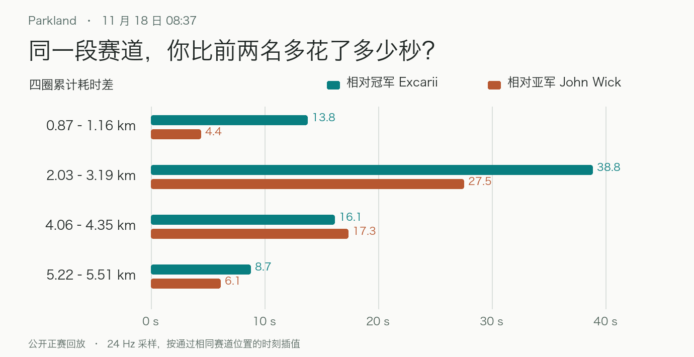

# zkdw66 最近八场赛车复盘

截至北京时间 11 月 18 日 09:40，最近八场计分赛车比赛均使用 v10。六场跑完四圈，其中一冠一季。排位全部在第五至第十，六场四圈完赛的正赛名次都比发车位高。最新 Parkland 的主要差距在弯区，Crossover 的两次低排名则各有具体事件。

## 八场成绩

| 完赛时间（北京时间） | 赛道 | 排位 → 正赛 | 冠军 | 亚军 | 你的成绩与比赛记录 |
| --- | --- | --- | --- | --- | --- |
| 11-18 08:37 | Parkland | 9 → 6 | Excarii | John Wick | 落后冠军 90.637 秒。[比赛](https://agx.cool/#/matches/b6287017-2152-4344-90b5-aa45aca1ad6c) |
| 11-18 06:37 | Crossover | 6 → 8 | reverse_learning | ☀ 🐂 | 完成 2 圈后损坏退赛，冠军 4 圈、亚军 3 圈。[比赛](https://agx.cool/#/matches/7d7b29ee-ace1-40c0-ac33-69ba4d51dff8) |
| 11-18 04:35 | Highland | 10 → 4 | Excarii | reverse_learning | 落后冠军 58.172 秒。[比赛](https://agx.cool/#/matches/05ba91c5-eae7-492b-ba78-83e07d6b8f33) |
| 11-18 02:34 | Highland | 5 → 3 | 江南曾听雨杨枝今何在 | reverse_learning | 落后冠军 93.296 秒。[比赛](https://agx.cool/#/matches/d9c6414e-d11e-4e7e-b124-ef8d7a8df8c9) |
| 11-18 00:37 | Highland | 7 → 1 | zkdw66 | 你有全面封锁我有平地起惊雷 | 领先亚军 8.921 秒完赛。[比赛](https://agx.cool/#/matches/7586385f-80e4-4606-acbb-f37b1a53fe68) |
| 11-17 22:39 | Crossover | 7 → 10 | ☀ 🐂 | King | 到全场时间上限时，你完成 0 圈，前两名均完成 3 圈。[比赛](https://agx.cool/#/matches/70b00f36-4a2d-4445-81ee-654a8c0ae172) |
| 11-17 20:38 | Crossover | 6 → 5 | reverse_learning | Excarii | 落后冠军 59.881 秒。[比赛](https://agx.cool/#/matches/858a542a-df0e-44fa-8c47-7d3e772cec94) |
| 11-17 18:32 | Crossover | 7 → 4 | reverse_learning | Yu Liu | 落后冠军 37.579 秒。[比赛](https://agx.cool/#/matches/08640570-c76a-422d-b794-5a7f9e9edd73) |

## 最新 Parkland，前两名快在哪里

| 指标 | 你 · zkdw66 | 冠军 · Excarii | 亚军 · John Wick |
| --- | ---: | ---: | ---: |
| 排位圈速（秒） | 97.332 | 92.369 | 89.640 |
| 正赛总时间（秒） | 482.301 | 391.664 | 407.403 |
| 正赛最快圈（秒） | 114.580 | 96.440 | 97.359 |
| 最高速度（km/h） | 342.9 | 313.2 | 339.8 |
| 满油门时间 | 33.8% | 58.9% | 53.0% |
| 刹车时间 | 27.9% | 17.3% | 22.3% |
| 4.06–4.35 km 区间均速（km/h） | 93.3 | 143.9 | 148.4 |

三辆车都完成四圈、零次进站。你的最高速度已超过两位对手；四圈在 2.03–3.19 km 弯区累计落后冠军 38.83 秒、亚军 27.51 秒，在 4.06–4.35 km 又分别落后 16.13 和 17.34 秒。两段合计解释对两人的总差距各约六成。你全场没有官方事故事件，终点还有 3.184 kg 燃油。冠军与你的前后翼、配重相同，起步多带了 1 kg 燃油。[官方比赛](https://agx.cool/#/matches/b6287017-2152-4344-90b5-aa45aca1ad6c)

本人日志显示，第一、二圈有 31.7% 和 43.2% 的在赛道决策受交通限速，第三、四圈降至 0.1% 和 0%。末圈仍有 28.2% 的决策请求刹车，全场没有触发省油。v10 在湿度达到 0.30 后，计算入弯制动距离时把减速度限制在低速轮胎抓地水平。高车速下已有可观测的气动下压力，旧版在入弯前较早收油刹车。弯心通过速度仍受行车路线与轮胎抓地估计约束。

## Crossover 的两个低排名

**第十名。** 正赛第 150–650 秒，15,001 次连续决策里，你都以低于 6 m/s 的速度跟着 12 米内的同一辆前车。v10 在这段时间一直选横向位置 −3 米作为超车目标，而前车也移到了这一侧。全部 15,001 次决策中，该目标与前车的横向间距都不足策略设定的 2.7 米。第 200 秒你车速约 9.7 km/h，前车约 9.6 km/h，距离约 7.3 米。策略既持续跟车，又沿着已被占用的路线行驶。官方记录了八次接触，比赛在 663.4 秒达到时间上限。[官方比赛](https://agx.cool/#/matches/70b00f36-4a2d-4445-81ee-654a8c0ae172)

**第八名。** 官方记录在发车后 63.2、69.6、130.4 秒发生接触，412.9 秒以损坏为由退赛。最后一个接触事件与退赛相隔约 282 秒，公开事件无法把全部损坏归到某一次接触。[官方比赛](https://agx.cool/#/matches/7d7b29ee-ace1-40c0-ac33-69ba4d51dff8)

## v11 本地候选版

1. **慢车移入目标路线时重新选边。** 在双方低速、前车仍在附近时，每次检查已选路线与前车的横向间距，并检查从当前位置到另一侧的整条横向通道。如果通道有车就暂停横移。纵向间距不足 6 米时，只允许向远离前车的一侧移动。候选版也包含工作区已有的切入预测与近距离碰撞制动。
2. **湿地按实测下压力规划入弯。** 湿地高速制动规划计入一半估算的额外气动抓地，随车速下降收回这部分余量，并受机械制动能力、横向轮胎负荷和坡度约束。50% 是候选版采用的工程参数。车辆设计沿用 v10，以便比较驾驶策略。

| 同一批官方输入 | v10 | v11 候选 |
| --- | ---: | ---: |
| Parkland 正赛刹车决策占比 | 27.8% | 23.7% |
| Parkland 正赛满油门决策占比 | 33.8% | 36.5% |
| Crossover 慢车窗口内，目标超车位置与前车相隔至少 2.7 米 | 0 / 15,001 | 15,001 / 15,001 |
| 同一慢车窗口内，触发紧急制动的决策 | 23 / 15,001 | 12,671 / 15,001 |

回放时赛车仍位于历史上的旧位置，因此同一帧里可以同时出现“规划另一侧”和“当前间距过近、必须制动”。另用匀速前车与空旷直道做双车简化仿真，从相距 7.3 米、同速 2.7 m/s、已选路线被占用开始；候选车在 10.27 秒后领先前车 8 米，v10 在 30 秒内持续跟车。该仿真没有真实轮胎、碰撞及对手反应。Parkland 的弯心速度和 Crossover 的真实超车成功率仍需新比赛检验。

两个官方本人席位导出均通过原始行数、字节和 SHA256 校验。v10 的 42,217 次输出全部与记录一致；候选版重放这 42,217 个输入，动作全部合法。139 项测试通过，30,000 次合成调用无异常或非法动作。湿度 0.8、胎温 55°C 的简化模型中，两版本均在三条赛道完成一圈、未越道路边缘。

官方成绩优先采用最终分类。公开场景和事件按官方 SHA256 核对；最新正赛另核对 95 个连续帧分块，共 12,059 个正赛采样。公开油门与刹车占比按在赛道上的时间计算，阈值分别为油门 >0.95、刹车 >0.05。分段耗时按各车通过相同赛道位置的时刻插值。验证表中的占比按本人决策次数计算。[八场成绩与验证数据](../experiments/v11-recent-races-2026-11-18.json)

本地参赛包为 [agx-racing-v11-candidate.zip](../dist/agx-racing-v11-candidate.zip)，SHA256 为 `7786c89635772cfbf10ae68e4a066ac4c27fac9980d644cff412de0b15fdcced`。AGX 已于北京时间 11 月 18 日 11:18 收到此包，11:19 核验准入通过，正式版本号为 11。[平台回执](../experiments/submission-v11.json)
